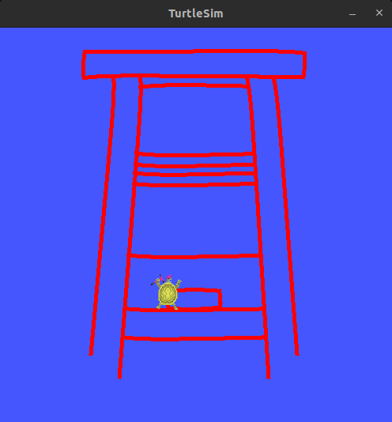
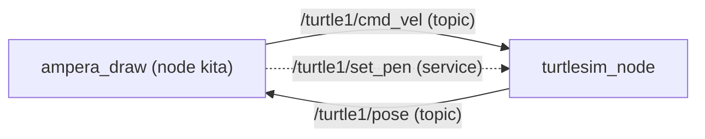
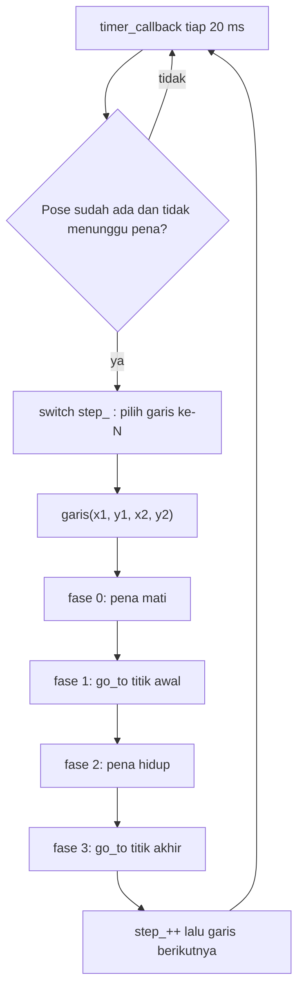

# turtle_kpp: Menggambar Logo di Turtlesim (ROS 2 + C++)

Program ROS 2 berbahasa C++ yang membuat penyu di **turtlesim** menggambar logo bangku secara otomatis. Penyu bergerak ke titik awal garis dengan pena mati, menyalakan pena, lalu bergerak ke titik akhir garis. Proses ini diulang untuk 20 garis sampai logo selesai.

> **Nama:** Gusti Ikhsan Nafyan Yuniza
> **NRP:** 2040261049

## Video penjelasan

Link video: https://drive.google.com/drive/folders/1O3QP8WxGSiNU3NBxxJPQc_qndiOMefbT?usp=sharing

## Hasil



## Daftar isi

1. [Fitur](#fitur)
2. [Struktur repo](#struktur-repo)
3. [Prasyarat](#prasyarat)
4. [Cara build dan menjalankan](#cara-build-dan-menjalankan)
5. [Konsep dasar ROS 2 yang dipakai](#konsep-dasar-ros-2-yang-dipakai)
6. [Arsitektur program](#arsitektur-program)
7. [Penjelasan kode](#penjelasan-kode)
8. [Koordinat logo](#koordinat-logo)
9. [Parameter yang bisa diubah](#parameter-yang-bisa-diubah)
10. [Pemecahan masalah](#pemecahan-masalah)

## Fitur

- Menggambar logo Jembatan Ampera di kanvas turtlesim 11 x 11.
- Pena dimatikan saat berpindah titik dan dihidupkan saat menggambar, sehingga tidak ada garis liar.
- Gerak penyu memakai **umpan balik posisi** (`/turtle1/pose`) dengan kontrol proporsional (P).
- Satu node saja, tanpa `std::vector`, memakai pola state machine (`step_` dan `fase_`) yang sederhana.

## Struktur repo

```
turtle_kpp/                      <- workspace ROS 2 (repo ini)
├── README.md
├── .gitignore
└── src/
    └── ampera_draw/             <- paket ROS 2
        ├── CMakeLists.txt
        ├── package.xml
        └── src/
            └── ampera_draw.cpp  <- source program
```

## Prasyarat

- Ubuntu dengan **ROS 2** (misalnya Humble) yang sudah terpasang.
- Paket `turtlesim`:
  ```bash
  sudo apt install ros-$ROS_DISTRO-turtlesim
  ```
- `colcon` dan compiler C++17 (`std::clamp` membutuhkan C++17).

## Cara build dan menjalankan

```bash
# 1. Clone repo (repo ini sudah berupa workspace ROS 2)
cd ~
git clone https://github.com/gstiikhsan/turtle_kpp.git
cd turtle_kpp

# 2. Build
source /opt/ros/$ROS_DISTRO/setup.bash
colcon build --packages-select ampera_draw

# 3. Jalankan (butuh dua terminal)
```

**Terminal 1** (simulator):
```bash
source /opt/ros/$ROS_DISTRO/setup.bash
ros2 run turtlesim turtlesim_node
```

**Terminal 2** (program menggambar):
```bash
cd ~/turtle_kpp
source install/setup.bash
ros2 run ampera_draw ampera_draw
```

Saat gambar selesai, terminal 2 mencetak `Done boskyuh`. Untuk mengulang dari awal, hapus kanvas lalu jalankan ulang program:

```bash
ros2 service call /clear std_srvs/srv/Empty
```

## Konsep dasar ROS 2 yang dipakai

| Istilah | Arti sederhana |
|---|---|
| **ROS 2** | Kerangka kerja untuk membuat program robot dari banyak program kecil yang saling berkomunikasi |
| **rclcpp** | Library ROS 2 untuk bahasa C++ (*ROS Client Library for C++*) |
| **Node** | Satu program kecil di ROS 2 |
| **Topic** | Jalur pesan satu arah (seperti siaran radio) |
| **Publisher / Subscriber** | Pengirim / penerima pesan pada sebuah topic |
| **Service** | Pola permintaan dan jawaban (client meminta, server membalas) |
| **Timer** | Pemicu yang memanggil fungsi tiap selang waktu tertentu |
| **Callback** | Fungsi yang dipanggil otomatis saat ada kejadian (pesan masuk, timer berbunyi) |
| **spin** | Membuat node tetap hidup dan menanggapi kejadian |

### Topic dan service turtlesim yang dipakai

| Nama | Jenis | Arah | Fungsi |
|---|---|---|---|
| `/turtle1/cmd_vel` | Topic (`geometry_msgs/Twist`) | Kita mengirim | Kecepatan maju (`linear.x`) dan putar (`angular.z`) |
| `/turtle1/pose` | Topic (`turtlesim/Pose`) | Kita menerima | Posisi `x`, `y`, dan arah hadap `theta` penyu |
| `/turtle1/set_pen` | Service (`turtlesim/SetPen`) | Kita meminta | Warna, tebal, dan pena hidup atau mati |

## Arsitektur program



Di dalam node ada **timer 20 ms** yang menjalankan state machine:



## Penjelasan kode

File: [`src/ampera_draw/src/ampera_draw.cpp`](src/ampera_draw/src/ampera_draw.cpp)

### 1. Konstruktor

```cpp
cmd_pub_  = create_publisher<Twist>("/turtle1/cmd_vel", 10);
pose_sub_ = create_subscription<Pose>("/turtle1/pose", 10, bind(&AmperaDraw::pose_callback, this, _1));
pen_client_ = create_client<SetPen>("/turtle1/set_pen");
timer_ = create_wall_timer(20ms, bind(&AmperaDraw::timer_callback, this));
```

Membuat empat hal: **publisher** untuk mengirim kecepatan, **subscriber** untuk menerima posisi, **client** untuk mengatur pena, dan **timer** 20 ms sebagai jantung program.

### 2. `pose_callback`: mencatat posisi penyu

```cpp
pose_ = *msg;
ada_pose_ = true;
```

Dipanggil otomatis setiap turtlesim menyiarkan posisi (bukan oleh timer kita). Nilai terbaru disimpan di `pose_`, dan `ada_pose_` menandai bahwa posisi sudah pernah diterima.

### 3. `timer_callback`: pengatur urutan (state machine)

```cpp
if (!ada_pose_ || waiting_pen_) return;
switch (step_) {
  case 0: if (garis(...)) step_++; break;
  ...
  default: berhenti, cetak pesan selesai, timer_->cancel();
}
```

- **Penjaga:** tidak bertindak jika posisi belum ada atau pena masih menunggu jawaban service.
- **`step_`:** nomor garis yang sedang digambar (0 sampai 19). Naik hanya saat `garis()` mengembalikan `true`.
- **Kenapa tidak pakai `for` dan `while`:** timer harus cepat selesai di tiap panggilan. Loop yang menunggu akan membekukan program sehingga posisi baru tidak terbaca. Maka "sudah sampai mana" diingat lewat `step_` dan `fase_`.

| Case | Bagian logo |
|---|---|
| 0 sampai 3 | Dudukan bangku |
| 4 sampai 7 | Empat kaki |
| 8 sampai 15 | Delapan anak tangga |
| 16 sampai 19 | Kotak kecil |

### 4. `garis()`: menggambar satu garis

| Fase | Aksi | Alasan |
|---|---|---|
| 0 | `pen(true)` : pena mati | Perpindahan ke titik awal tidak meninggalkan coretan |
| 1 | `go_to(x1, y1)` | Menuju titik awal garis |
| 2 | `pen(false)` : pena hidup | Mulai menggambar |
| 3 | `go_to(x2, y2)` | Jejak penyu menjadi garis. Setelah sampai, `fase_ = 0` dan mengembalikan `true` |

### 5. `go_to()`: membawa penyu ke satu titik (kontrol P)

```cpp
double distance = hypot(x - pose_.x, y - pose_.y);
if (distance < 0.03) { berhenti; return true; }

double err = atan2(dy, dx) - pose_.theta;
err = atan2(sin(err), cos(err));          // normalisasi ke -pi..pi

cmd.angular.z = 6.0 * err;
if (fabs(err) < 0.15) cmd.linear.x = clamp(3.0 * distance, 0.3, 3.0);
```

- **Jarak:** rumus Pythagoras ke target. Di bawah 0,03 satuan dianggap sudah sampai.
- **Error sudut:** selisih arah menuju target dan arah hadap penyu. Dinormalisasi agar penyu memilih putaran terpendek.
- **Putar:** kecepatan putar = 6 x error (kontrol **proporsional**).
- **Maju:** hanya jika arah sudah hampir tepat (< 0,15 rad), kecepatan = 3 x jarak sehingga melambat saat mendekat, dibatasi 0,3 sampai 3,0.

> Kontrol di sini hanya **P**, bukan PID penuh. Untuk penyu virtual tanpa gesekan atau gangguan, P sudah cukup.

### 6. `pen()`: mengatur pena lewat service secara asinkron

```cpp
req->r = 255; req->g = 0; req->b = 0; req->width = 5;
req->off = off ? 1 : 0;
waiting_pen_ = true;
pen_client_->async_send_request(req, [this](auto) { waiting_pen_ = false; });
```

Permintaan dikirim tanpa menunggu (asinkron). Selama jawaban belum datang, `waiting_pen_ = true` dan `timer_callback` langsung keluar. Saat jawaban tiba, lambda mengembalikannya ke `false`. Ini memastikan penyu tidak bergerak sebelum status pena benar-benar berganti.

### 7. Variabel penting

| Variabel | Fungsi |
|---|---|
| `pose_` | Posisi penyu terbaru (x, y, theta) |
| `ada_pose_` | Sudah menerima posisi atau belum |
| `waiting_pen_` | Sedang menunggu jawaban service pena |
| `step_` | Garis ke berapa (0 sampai 19) |
| `fase_` | Tahap di dalam satu garis (0 sampai 3) |

### 8. Posisi awal penyu

Turtlesim memunculkan penyu di tengah kanvas (sekitar 5,54 ; 5,54) menghadap kanan. Posisi awal tidak perlu diatur karena `go_to()` selalu bekerja berdasarkan posisi penyu saat ini. Pena dimatikan di fase 0, sehingga perjalanan ke titik pertama tidak menimbulkan coretan.

## Koordinat logo

Koordinat dirancang di GeoGebra dengan pusat logo di (0, 0), lalu diubah ke kanvas turtlesim 11 x 11 dengan rumus:

```
x' = 5.5 + 2x
y' = 5.5 + 2y
```

Hasilnya logo berukuran sekitar 8,9 x 9,9 satuan dan berada di kuadran 1 (titik (0,0) kanvas ada di kiri bawah).

| Bagian | Jumlah garis | Contoh titik (x1, y1) ke (x2, y2) |
|---|---|---|
| Dudukan | 4 | (2.40, 9.70) ke (8.60, 9.70) |
| Kaki | 4 | (3.26, 9.70) ke (2.60, 1.90) |
| Anak tangga | 8 | (3.98, 9.44) ke (7.02, 9.44) |
| Kotak kecil | 4 | (4.76, 3.68) ke (6.24, 3.68) |

## Parameter yang bisa diubah

| Parameter | Lokasi | Nilai | Pengaruh |
|---|---|---|---|
| Periode timer | konstruktor | `20ms` | Makin kecil, kontrol makin halus tetapi lebih berat |
| Toleransi sampai | `go_to()` | `0.03` | Makin kecil, penyu makin presisi tetapi lebih lama |
| Gain putar | `go_to()` | `6.0` | Makin besar, putaran makin tajam (bisa berosilasi) |
| Gain maju | `go_to()` | `3.0` | Makin besar, makin cepat mendekati target |
| Ambang menghadap | `go_to()` | `0.15` rad | Batas error sudut sebelum penyu boleh maju |
| Warna dan tebal pena | `pen()` | `255,0,0` dan `5` | Mengubah tampilan garis |

## Pemecahan masalah

| Masalah | Penyebab dan solusi |
|---|---|
| `colcon build` gagal karena `std::clamp` | Pastikan C++17 aktif (sudah diatur di `CMakeLists.txt`) |
| Penyu tidak bergerak | Pastikan `turtlesim_node` sudah berjalan lebih dulu di terminal 1 |
| Penyu hanya menggambar garis pertama | Pastikan `garis()` mengembalikan `true` di fase 3 |
| `Package 'ampera_draw' not found` | Jalankan `source install/setup.bash` di terminal 2 |
| Gambar lama masih ada saat dijalankan ulang | Jalankan `ros2 service call /clear std_srvs/srv/Empty` |

README.md Dibuat dengan bantuan AI.